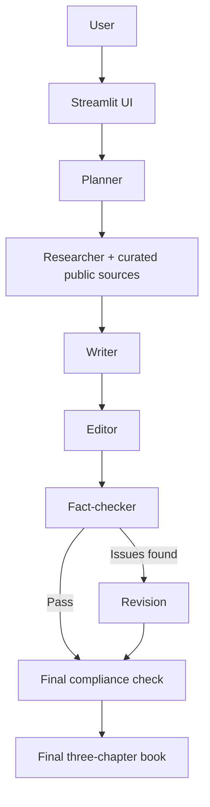

# Architecture

## Agent Handoffs

- The Streamlit UI passes the book brief to the Planner and displays progress as each stage runs.
- The Planner returns a structured outline; the application rejects anything other than three complete chapter plans.
- For each chapter, the Researcher fetches the public source catalog in `agents.py`, extracts page text, and returns a short brief. The same excerpts and source list are passed to the Writer and Fact-checker.
- The Writer returns prose with chapter-local citation numbers. The application rebuilds References from the fixed catalog, rather than accepting model-invented URLs.
- The Editor improves the prose while preserving citations and structure.
- The Fact-checker evaluates claims against the retrieved evidence and sources. A failed fact-check or local structure check can invoke one targeted Revision.
- The final compliance check verifies all three chapters, their word counts, required ending sections, citation/reference matches, and HTTP(S) source URLs.

## Stop Conditions

The workflow stops with a clear error if fewer than two curated sources can be fetched, the chapter plan is invalid, or a chapter still fails compliance after its single revision. Otherwise, the final book, trace, sources, and Markdown download are returned to Streamlit. Research retrieval uses direct HTTPS and does not use Google Search grounding. The fact-checker reuses retrieved evidence, reducing extra Gemini calls.
